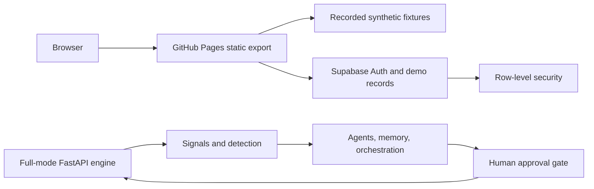

# STRATA

<p align="center"><strong>Operational intelligence for business teams</strong></p>
<p align="center">See what changed. Understand why. Decide what happens next.</p>

<p align="center">
  <a href="https://strata-ai.me">Live demo</a> ·
  <a href="#try-it-in-10-seconds">Try it in 10 seconds</a> ·
  <a href="#whats-live-vs-simulated">Live vs simulated</a> ·
  <a href="#run-the-full-mode-locally">Run locally</a>
</p>

<p align="center">
  
  
  
</p>

## ✦ See it think


The walkthrough shows a synthetic role entering the console, inspecting a recorded incident, reviewing cited investigation evidence, opening the audit trail, and using the How it works panel. [Watch the full video](docs/media/strata-demo.mp4).

**Live demo:** [strata-ai.me](https://strata-ai.me). The static deployment is an honest replay. Its data is synthetic and it does not run a browser model or the engine pipeline.

## Try it in 10 seconds

Open the [live demo](https://strata-ai.me), choose a **Quick demo access** card, and enter the console. These credentials are intentionally fake, local to your browser, and use the displayed password `demo-only`.

| Role | Synthetic account | Password |
| --- | --- | --- |
| Business Head | `business.head@altygen.demo.invalid` | `demo-only` |
| Operations Manager | `operations.manager@altygen.demo.invalid` | `demo-only` |
| Account Manager | `account.manager@altygen.demo.invalid` | `demo-only` |
| Sales Manager | `sales.manager@altygen.demo.invalid` | `demo-only` |
| Support Manager | `support.manager@altygen.demo.invalid` | `demo-only` |
| QA Head | `qa.head@altygen.demo.invalid` | `demo-only` |

Google sign-in is available after Supabase and Google OAuth are configured. A first-time Google user either redeems a demo join code or selects a demo role. Google users have a separate sandbox: they can reset only their own saved demo changes.

## Company details

**Altygen Biopharm** is a fictional profile used only in the demo. It models a 180-person nephrology-pharma B2B team headquartered in Gurugram, India for District 05, Intelligent Business Operations & Customer Engagement. The departments are Operations, Accounts, Sales, Support, and Quality assurance. The demo team has a Business Head plus Operations, Account, Sales, Support, and QA managers.

| Demo code | Role | Purpose |
| --- | --- | --- |
| `ALTADM` | Business Head | Admin and company manager |
| `ALTEMP` | Account Manager | General employee |
| `ALTOPS` | Operations Manager | Operations department |
| `ALTACC` | Account Manager | Accounts department |
| `ALTSAL` | Sales Manager | Sales department |
| `ALTSUP` | Support Manager | Support department |
| `ALTQA1` | QA Head | Quality assurance department |

Codes are public demo credentials, not production secrets. In Supabase, each redemption is authenticated, atomically counted, rejects invalid, expired, or already-used codes, and is protected by row-level security.

## What's live vs simulated

| Feature | Static demo behavior | Full-mode implementation |
| --- | --- | --- |
| Signals and Sentinel detection | Recorded synthetic outputs | [signals](https://github.com/Yog05esh/Yog05esh.github.io/blob/main/services/engine/strata_engine/signals.py) and [detection](https://github.com/Yog05esh/Yog05esh.github.io/blob/main/services/engine/strata_engine/detect.py) |
| Investigator and Evidence-or-Silence | Recorded cited investigation | [agents](https://github.com/Yog05esh/Yog05esh.github.io/blob/main/services/engine/strata_engine/agents.py) |
| Memory | Recorded prior cases and SOPs | [agents](https://github.com/Yog05esh/Yog05esh.github.io/blob/main/services/engine/strata_engine/agents.py) |
| Orchestrator and routines | Scripted approvals, tasks, and handoffs | [agentic workflow](https://github.com/Yog05esh/Yog05esh.github.io/blob/main/services/engine/strata_engine/agentic.py) |
| Simulation Lab | Saved scenario replay and illustrative outcome | [simulation](https://github.com/Yog05esh/Yog05esh.github.io/blob/main/services/engine/strata_engine/simulation.py) |
| Assistant | Suggested questions and pre-written cited answers, no browser LLM call | [static assistant adapter](https://github.com/Yog05esh/Yog05esh.github.io/blob/main/apps/web/src/lib/demo-api.ts) and [engine assistant](https://github.com/Yog05esh/Yog05esh.github.io/blob/main/services/engine/strata_engine/assistant.py) |
| Audit chain | Recorded event fixture | [state](https://github.com/Yog05esh/Yog05esh.github.io/blob/main/services/engine/strata_engine/state.py) |
| Login and saved demo changes | Google OAuth and per-user Supabase sandbox when configured | [Supabase schema](supabase/schema.sql) |

Every static screen visibly says **Demo mode: simulated output** and has a short, interactive How it works panel. Existing provenance labels such as **SYNTHETIC DATA, NOT ALTYGEN'S** remain in the product UI.

## Architecture



## Static demo deployment

The `static-demo` branch uses `NEXT_PUBLIC_DEMO=1` to export `apps/web/out` for GitHub Pages. It contains no service-role key and makes no engine calls. Only `NEXT_PUBLIC_SUPABASE_URL` and `NEXT_PUBLIC_SUPABASE_PUBLISHABLE_KEY` may be exposed to the browser. The Pages workflow builds with Node 20, uses GitHub repository variables for those public values, uploads `apps/web/out`, and includes the `CNAME` and `404.html` assets.

For deployment instructions, DNS records, Supabase configuration, Google OAuth configuration, and GitHub variables, see [docs/DEPLOYMENT.md](docs/DEPLOYMENT.md).

## Run the full mode locally

Requirements: Node 20+, Python 3.12+, and optionally Docker for the bundled services.

```bash
cp .env.example .env
npm install
npm --prefix apps/web install
npm run dev
```

Start the engine according to the scripts and service instructions in this repository, then open the local web URL shown by Next.js. Keep `NEXT_PUBLIC_DEMO=0` for full mode.

Environment variable names only: `STRATA_MODE`, `STRATA_STORE`, `STRATA_SEED`, `LLM_PROVIDER`, `LLM_MODEL`, `EMBED_PROVIDER`, `EMBED_MODEL`, `EMBED_DIM`, `LLM_MAX_CALLS_PER_HOUR`, `SIM_NOW`, `ENGINE_URL`, `NEXT_TELEMETRY_DISABLED`, `APP_URL`, `STRATA_AUTH_SECRET`, `STRATA_ADMIN_KEY`, `STRATA_DEMO_LOGINS`, `NEXT_PUBLIC_DEMO`, `NEXT_PUBLIC_SUPABASE_URL`, `NEXT_PUBLIC_SUPABASE_PUBLISHABLE_KEY`, `SMTP_HOST`, `SMTP_PORT`, `SMTP_USER`, `SMTP_PASSWORD`, `SMTP_FROM`, `SMTP_FROM_NAME`, `GEMINI_API_KEY`, `GEMINI_MODEL`, `SUPABASE_DB_URL`, `SUPABASE_URL`, and `SUPABASE_PUBLISHABLE_KEY`.

## Project layout

| Path | Purpose |
| --- | --- |
| `apps/web/` | Next.js console, static export, and fixture adapter |
| `services/engine/strata_engine/` | FastAPI engine, detection, agents, simulation, assistant, and audit state |
| `supabase/schema.sql` | Public-demo companies, profiles, join codes, RLS, and sandbox records |
| `docs/` | Deployment guide, product references, and demo media |

No real company data, credentials, or production performance claims are included in this repository.
